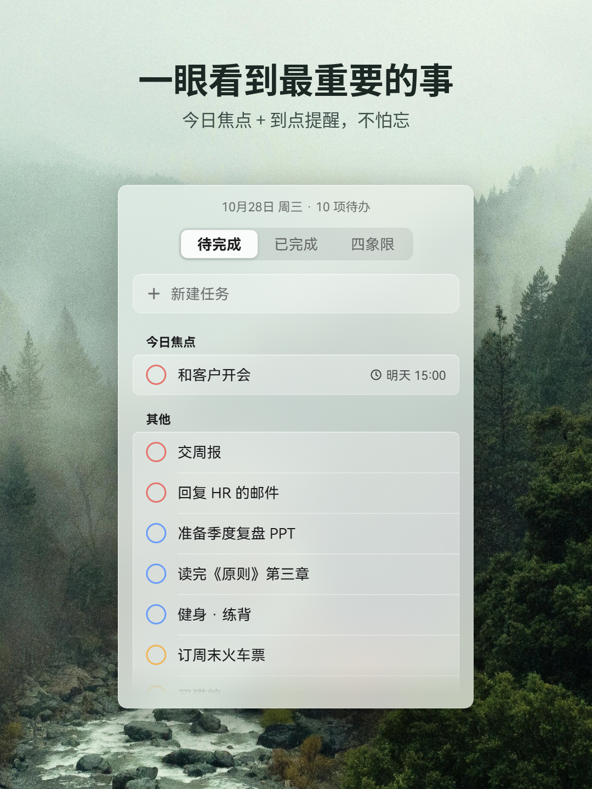
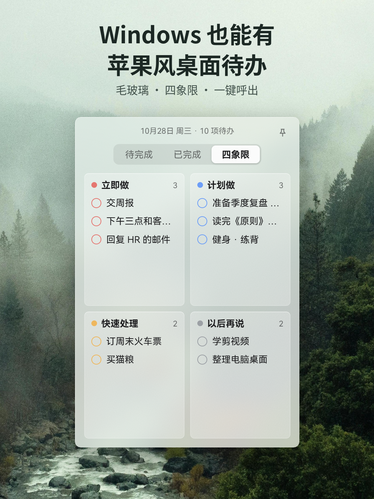
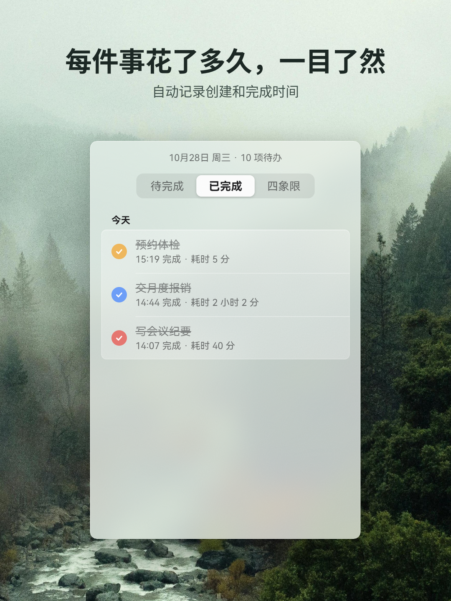

# Mist Todo

一个贴在 Windows 桌面上的毛玻璃待办小组件：平时安静地停在桌面层，按一下快捷键就能叫出来记事。

## 截图

## 功能

- **毛玻璃小组件**：半透明磨砂窗口，跟随系统浅色 / 深色模式；平时停在桌面层，不挡其他窗口
- **随叫随到**：快捷键 `Alt+Shift+T` 或点托盘图标呼出 / 隐藏，呼出后直接输入新任务
- **三个视图**：待完成 / 已完成 / 四象限（立即做、计划做、快速处理、以后再说），`Ctrl+1 / 2 / 3` 切换
- **四象限拖动**：拖动任务就能换象限；新建时末尾写 `!1` ~ `!4` 直接指定象限
- **时间识别与提醒**：标题里写"明天下午3点""周三晚""30分钟后"会自动识别成提醒时间；到点弹出系统通知，可以直接点"完成 / 30 分钟后 / 明天"
- **过期标红**：过了时间还没完成的任务标红，托盘图标出现红点
- **今日焦点**：每天最多选 3 项，排在列表最上面
- **早上开工简报**：每天第一次解锁电脑时，帮你看一眼今天的安排
- **勿扰**：系统开着"请勿打扰"时不弹通知，结束后补上；也可以暂停提醒 1 小时
- **撤销**：完成、删除、移动之后 3 秒内可以撤销
- **数据在本地**：所有任务只保存在你自己的电脑上（`%APPDATA%\com.misttodo.app\`），不联网、不上传

## 下载和使用

1. 打开本仓库的 [Releases 页面](../../releases)，下载 `mist-todo-v0.2.1-beta.exe`
2. 双击运行即可，不需要安装
3. 系统要求：Windows 10 / 11（Windows 11 一般自带所需组件；如果 Windows 10 上双击没反应，请安装微软的 [WebView2 运行时](https://developer.microsoft.com/microsoft-edge/webview2/)）

关闭窗口只是藏到托盘；真正退出请右键托盘图标 →「退出」。

## 打开时提示"Windows 已保护你的电脑"怎么办

目前的版本没有做代码签名，Windows 对没见过的程序都会这样提醒：

1. 点提示窗口里的 **「更多信息」**
2. 再点出现的 **「仍要运行」**

以后再打开就不会再提示了。

## 测试版说明

目前是测试版，可能还有不完善的地方。遇到问题或有建议，欢迎在 [Issues](../../issues) 里提出来。

## 字体

软件界面使用 HarmonyOS Sans SC 字体（© Huawei Device Co., Ltd.，HarmonyOS Sans Fonts License Agreement）。
